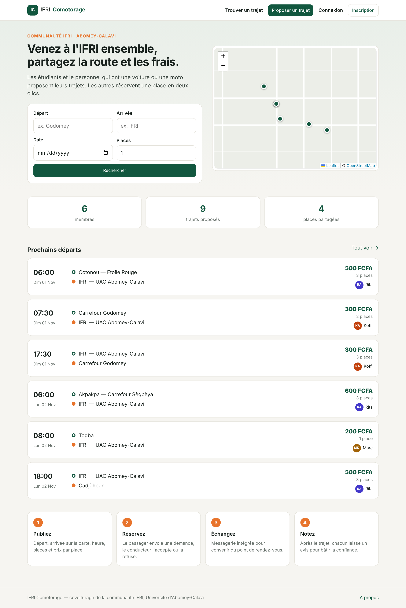
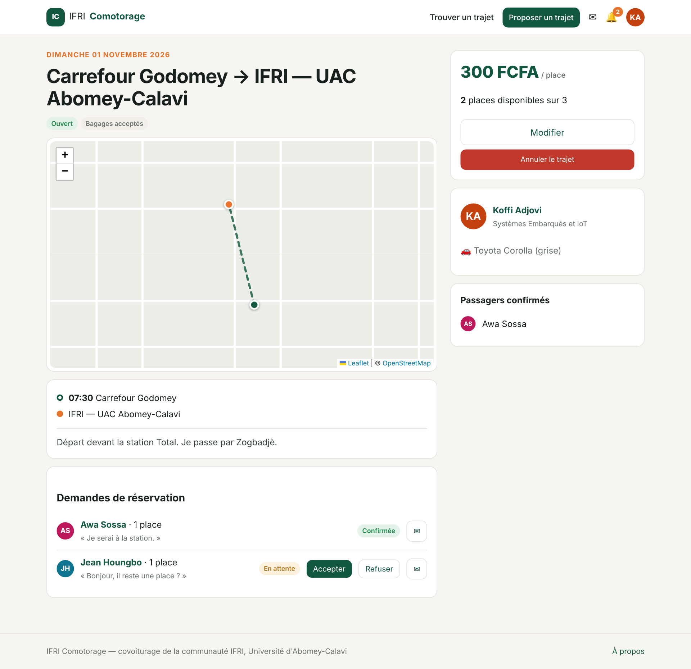
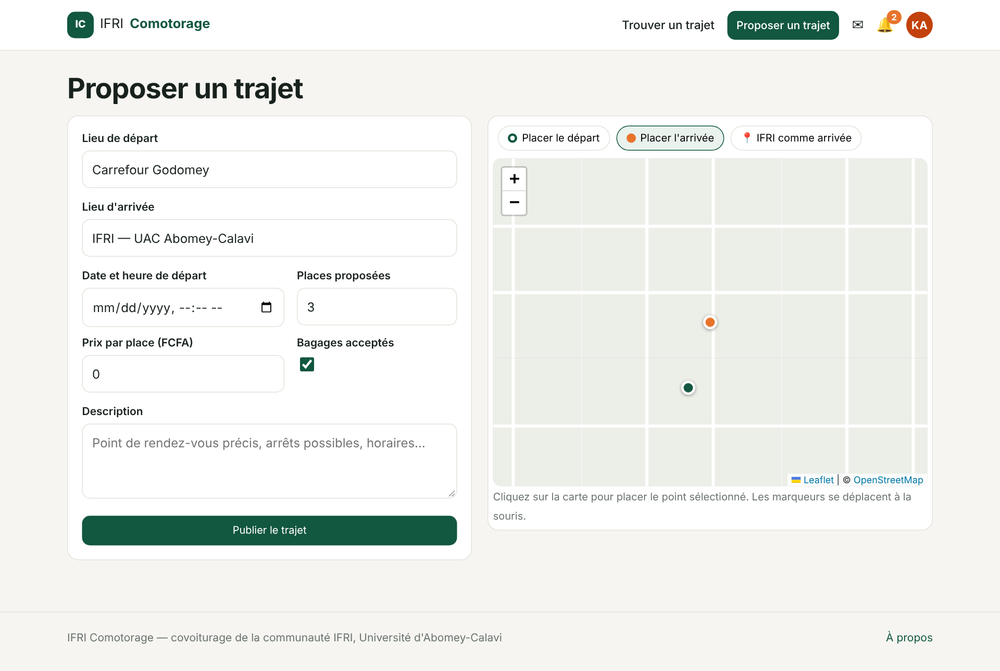
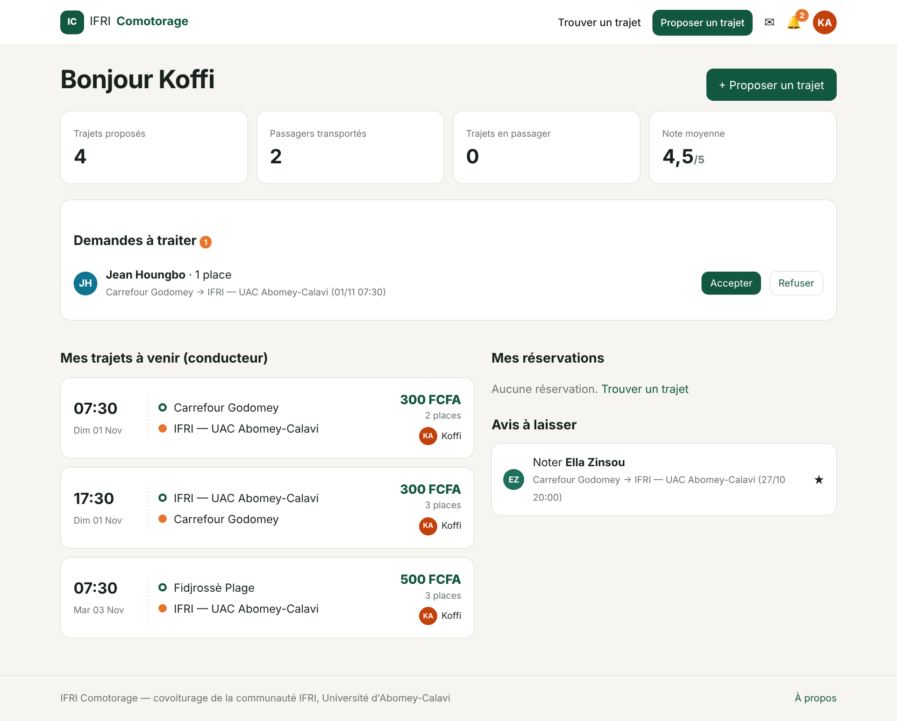
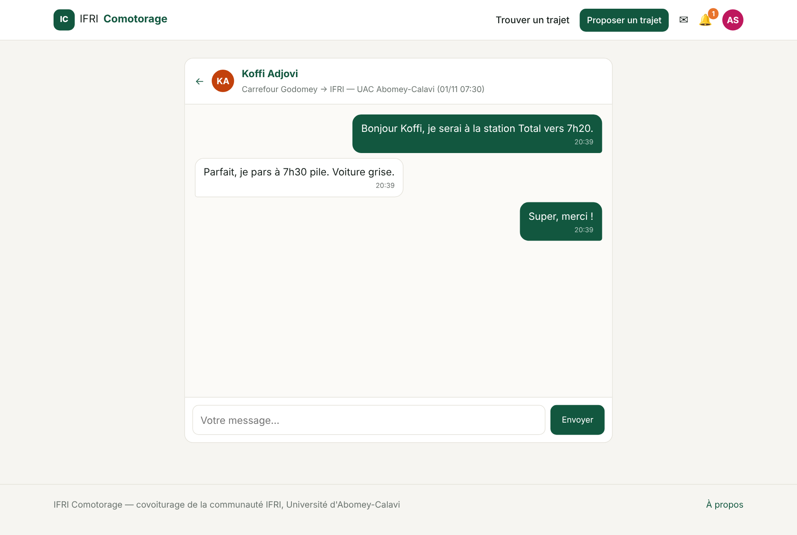
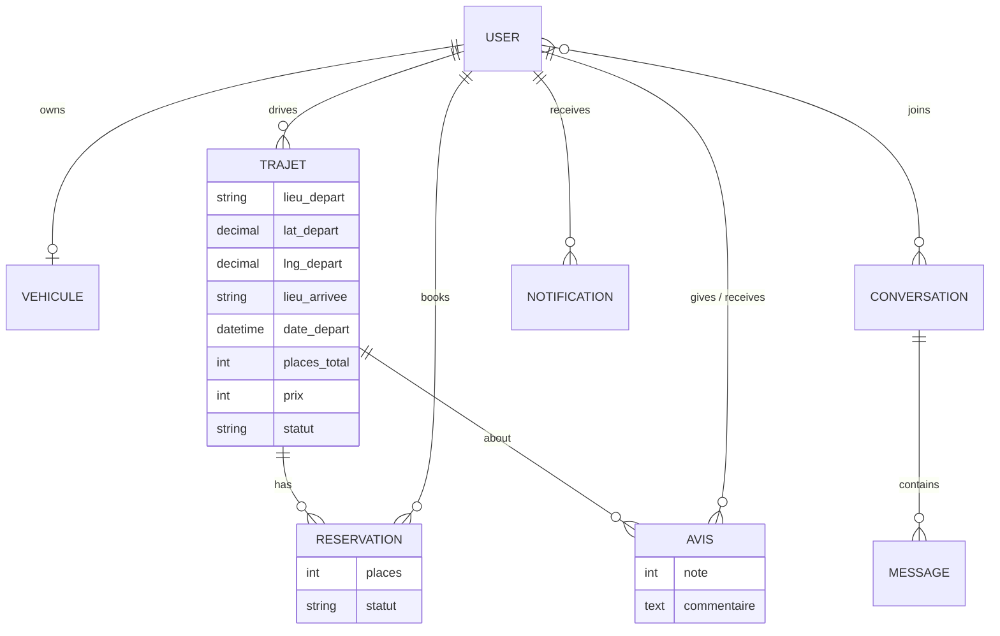

# IFRI Comotorage — Carpooling for the IFRI community

Django web application that connects **drivers** and **passengers** of the IFRI community (Université d'Abomey-Calavi, Benin): drivers publish their rides to campus, passengers book a seat, everyone chats in the app and rates each other after the ride.

Integrated project (PIL1, 2024-2025) — **Python · Django 5 · MySQL · Leaflet / OpenStreetMap**.



## Features

| Area | What it does |
| --- | --- |
| **Accounts** | sign-up (filière, role: passenger / driver / both), login, logout |
| **Profile** | public profile, average rating, reviews received, vehicle (make, model, colour, seats) |
| **Publish a ride** | departure and arrival **placed on a Leaflet map** (click or drag; "IFRI as destination" shortcut), date/time, seats, price per seat, luggage, notes |
| **Search** | filter by departure, arrival, date and seats needed; past, cancelled and full rides hidden |
| **Booking** | request → driver **accepts or refuses** → seats updated; ride becomes *full* automatically and *open* again if a passenger cancels; a driver can cancel the ride (passengers notified) |
| **Messaging** | conversations between members, linked to a ride; instant updates by polling every 3 s (no extra server) |
| **Notifications** | new request, accepted, refused, cancellation, new message, new review — with unread counters in the menu |
| **Reviews** | after the ride, driver ⇄ passengers rate each other (1–5 ★ + comment), once per person and per ride |
| **Dashboard** | stats (rides offered, passengers carried, rating), requests to handle, upcoming rides and bookings, reviews to leave |

Booking rules are enforced in one place (`trajets/services.py`) inside database transactions with row locking (`select_for_update`), so simultaneous requests or acceptances can never overbook a ride.

## Screenshots

| Ride page (driver) | Publish a ride |
| --- | --- |
|  |  |
| **Dashboard** | **Messaging** |
|  |  |

More in [`ifri_comotorage_ui/`](ifri_comotorage_ui/README.md).

## Project structure

```
ifri-comotorage/
├── manage.py
├── requirements.txt
├── base_e_donnees.sql            MySQL dump: full schema + demo data
├── rapport.html                  project report
├── covoiturage_app/              Django configuration (settings.py, urls.py)
├── accueil_covoiturage_app/      home page, about
├── users/                        custom User model (role, filière, phone)
├── login/                        sign-up, login, logout
├── profil/                       public profile, profile edit, Vehicule model
├── trajets/                      Trajet & Reservation models, search, ride page, booking rules (services.py)
├── publication_offre/            publish / edit / cancel a ride (map form)
├── avis/                         Avis model, rating rules
├── messaging/                    Conversation & Message, JSON API for instant messaging
├── notifications/                Notification model, notifier() service, list and counters
├── dashboard/                    user dashboard
├── core/                         shared helpers: context processor, template tags, demo data command
├── templates/                    global HTML templates
├── static/                       CSS, JS (maps, chat), Leaflet (vendored)
└── ifri_comotorage_ui/           interface screenshots
```

## Data model



## Installation

```bash
git clone https://github.com/bradley1101/ifri-comotorage.git
cd ifri-comotorage
python -m venv venv
venv\Scripts\activate            # Windows  (Linux/macOS: source venv/bin/activate)
pip install -r requirements.txt
```

**Option A — SQLite (quick start, nothing to install):**

```bash
python manage.py migrate
python manage.py seed_demo       # demo members and rides
python manage.py runserver       # http://127.0.0.1:8000
```

**Option B — MySQL / MariaDB (XAMPP, WAMP…):**

```bash
mysql -u root -p < base_e_donnees.sql          # creates the "comotorage" database with demo data
set DB_ENGINE=mysql                             # Linux/macOS: export DB_ENGINE=mysql
set DB_USER=root
set DB_PASSWORD=your-password
python manage.py migrate                        # nothing to apply: the dump is in sync
python manage.py runserver
```

All settings are read from environment variables, see [`.env.example`](.env.example).

**Demo accounts** (password `ifri2025demo`): `koffi`, `rita`, `marc` (drivers) — `awa`, `jean`, `ella` (passengers). Admin: `python manage.py createsuperuser`, then `/admin/`.

## Tests

```bash
python manage.py test
```

32 tests, run on **both SQLite and MySQL**:

- booking rules: own ride, seats, past or cancelled ride, double booking, re-booking after refusal, *full* / *open* transitions, driver-only actions, ride cancellation;
- publication: map points required, future date, seats ≤ vehicle, no reduction below confirmed seats, ownership;
- reviews: participants only, after the ride, once;
- messaging: one conversation per pair, unread state, no notification spam, privacy;
- sign-up and every page for visitors and members.

---
**Author:** Maël Alain Bradley AZAÏNON — Embedded Systems & IoT, IFRI
