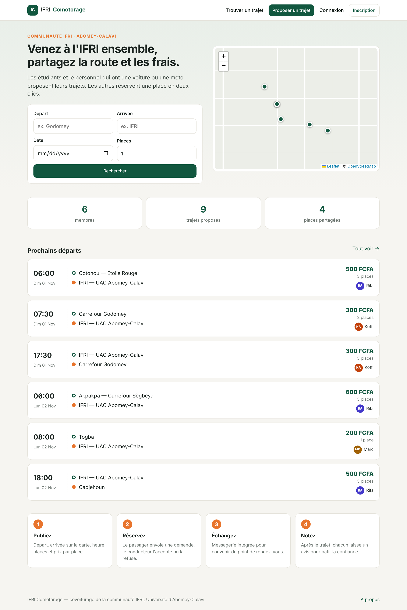
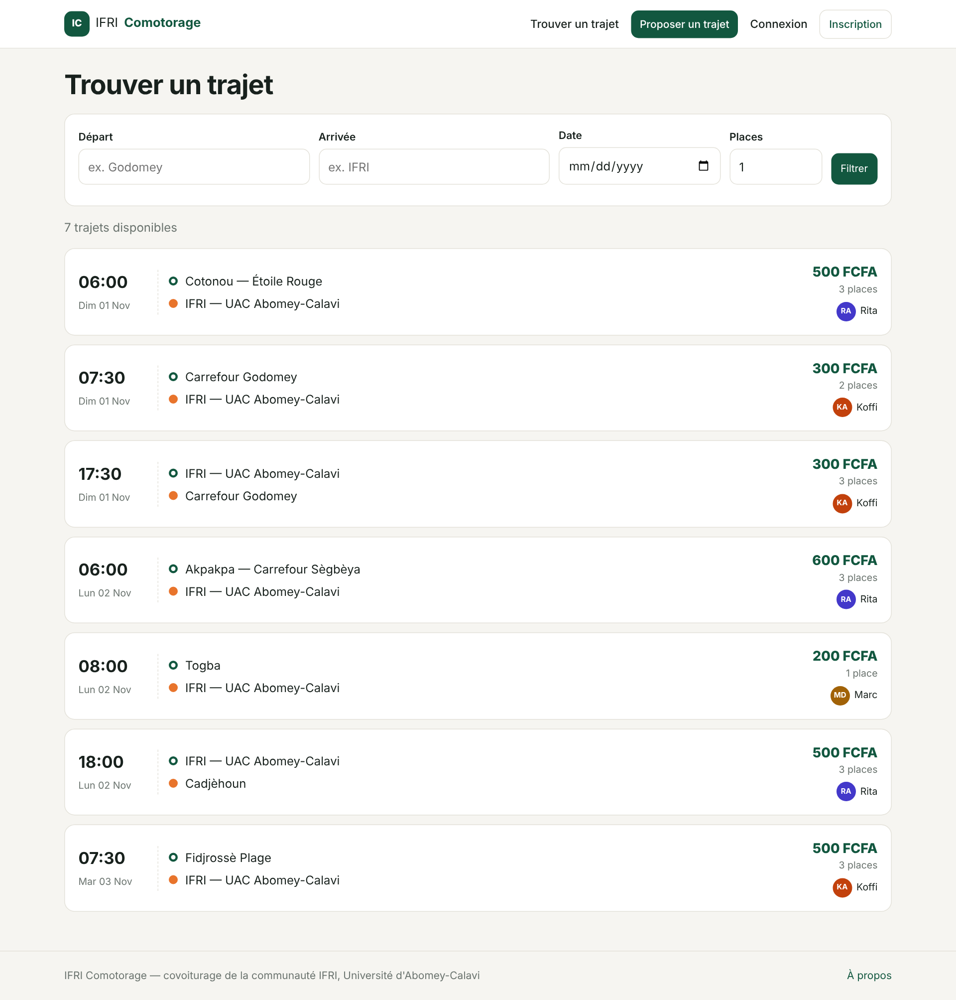
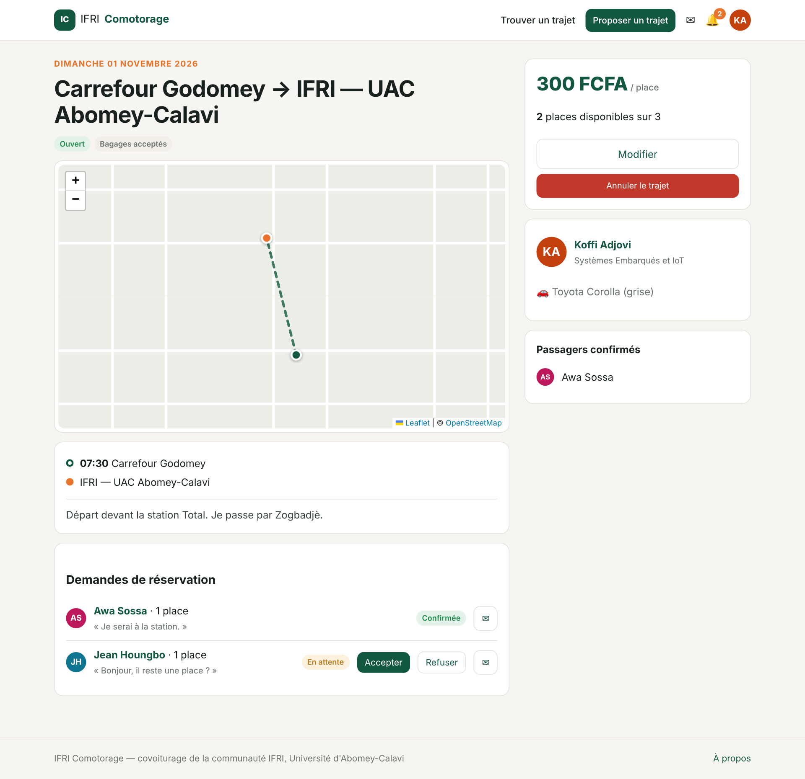
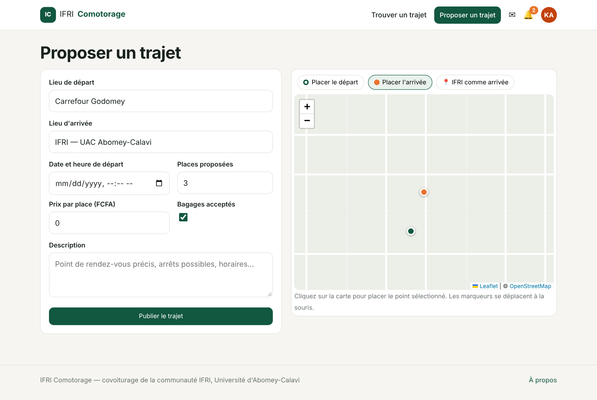
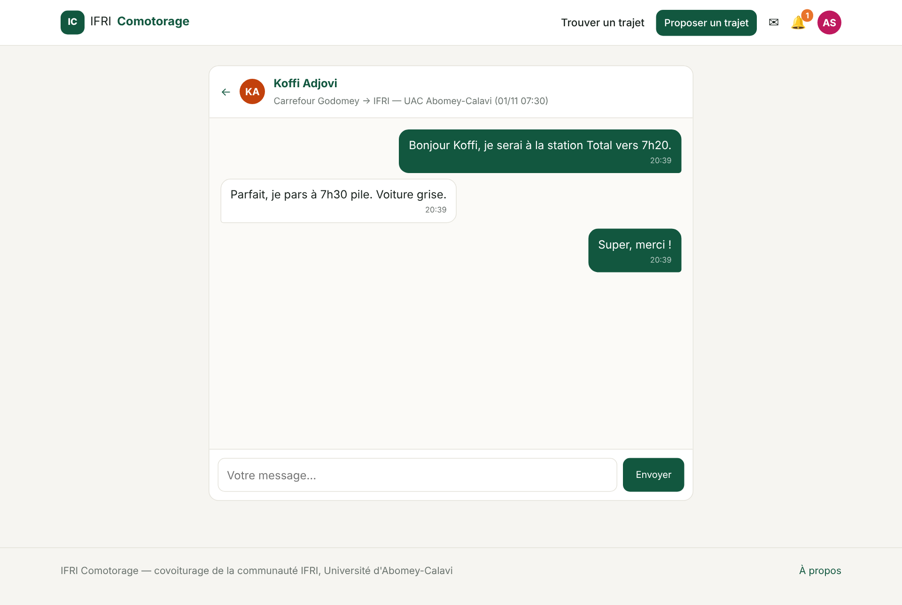
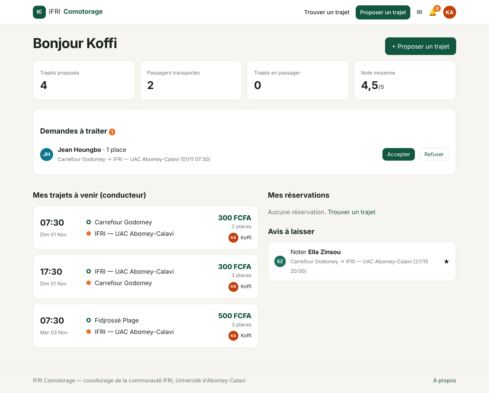
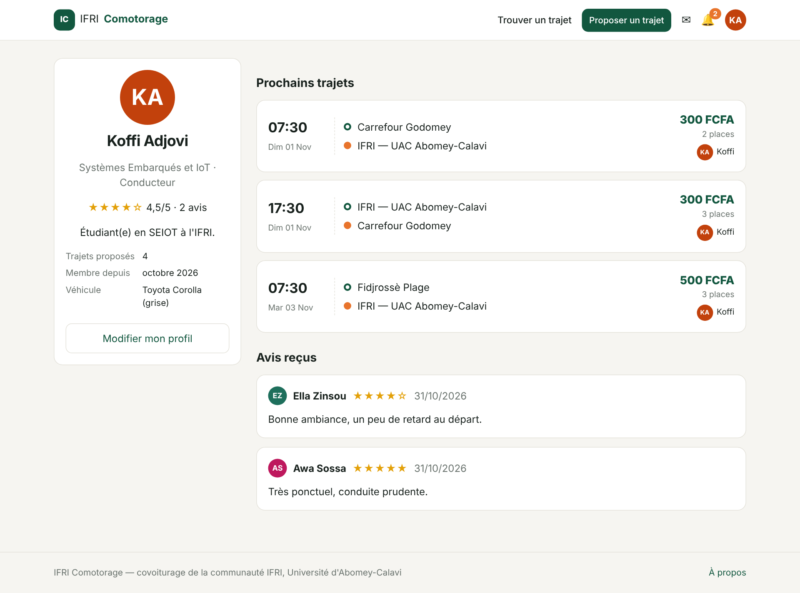
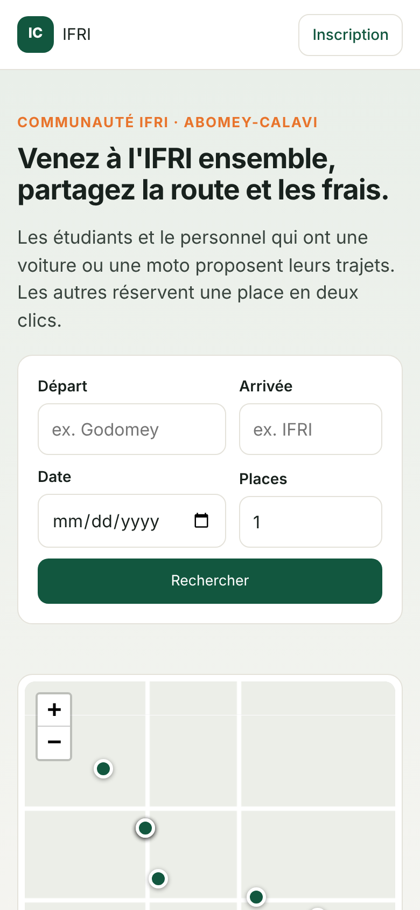

# Interface — screenshots

Screenshots of the application running on MySQL with the demo data (`python manage.py seed_demo`).

> The OpenStreetMap tiles are replaced by a neutral background in these screenshots, because the capture environment had no access to the tile server. In normal use the real map is displayed.

| | |
| --- | --- |
|  **Home** — search, map of departures, next rides |  **Search** — filters by departure, arrival, date, seats |
|  **Ride page (driver view)** — route map, requests to accept or refuse |  **Publish a ride** — departure and arrival placed on the map |
|  **Messaging** — conversation linked to a ride |  **Dashboard** — stats, pending requests, bookings, reviews to leave |
|  **Public profile** — rating, vehicle, reviews |  **Mobile** — responsive layout |
